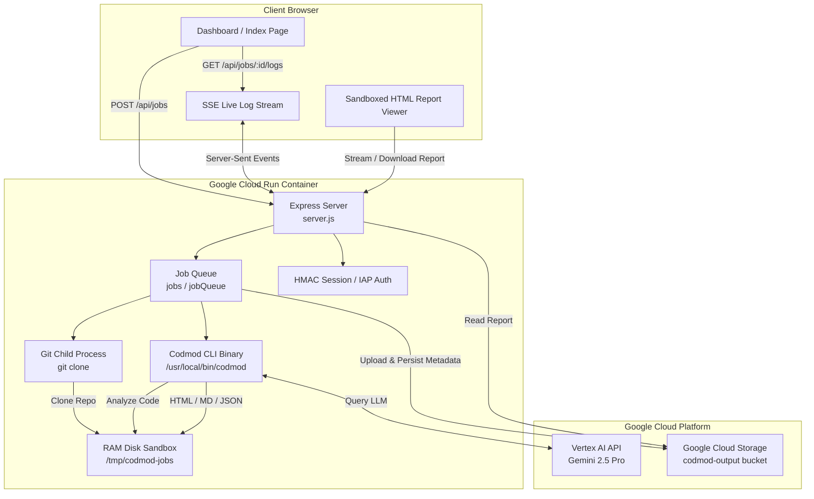

# Google Codmod Web Wrapper

A premium, production-ready web GUI wrapper around Google Cloud's **App Modernization Assessment (`codmod`)** tool. Designed to make evaluating legacy repositories with Vertex AI and Gemini 2.5 Pro seamless, interactive, and easy to deploy on **Google Cloud Run**.

---

## 🌟 Key Features

- **Interactive Modernization Dashboard**: Intuitive web interface built with a Google Cloud Console aesthetic.
- **Flexible Repository Sources**:
  - **Git Repositories**: Clone standard HTTPS repositories with optional Username & Password / PAT authentication for private GitHub, GitLab, or Bitbucket repositories. Secrets are kept in-memory only during cloning and are automatically redacted from logs and GCS history.
  - **Local Folder Repositories**: Process repositories directly from your local disk or mounted volume using an interactive Windows/Mac-style Folder Browser Dialog in the Web GUI without pushing to Git.
- **Real-Time Log Streaming**: Streams live assessment progress and command stdout/stderr via Server-Sent Events (SSE).
- **Google Cloud Storage (GCS) Integration**: Automatically archives generated HTML, Markdown, or JSON assessment reports to your target GCS bucket.
- **Hybrid Authentication**: Support for both built-in application passcode authentication and Google Cloud Identity-Aware Proxy (IAP) + Load Balancer edge authentication.
- **Sandboxed Execution**: Clones or copies repositories into secure temporary workspaces and cleans up automatically after execution.
- **Local Fallback Mode**: Run locally without GCP credentials using mock storage and mock CLI binaries for rapid frontend development and testing.

---

## 🏗️ Architecture



---

## 📋 Prerequisites

- **Node.js 20.x** or higher
- **Docker** (optional, for containerized testing and builds)
- **Google Cloud Platform Project** with:
  - `run.googleapis.com` (Cloud Run)
  - `aiplatform.googleapis.com` (Vertex AI API)
  - `storage.googleapis.com` (Cloud Storage)

---

## 🚀 How to Run the Application

You can run the Codmod Web Wrapper locally using Docker Compose, standalone with Node.js, or deploy it to production on Google Cloud Run.

### Option 1: Running Locally with Docker Compose
Run the complete containerized application locally while connecting to your Google Cloud Storage bucket and Vertex AI using your host's Application Default Credentials (ADC).

1. **Authenticate with Google Cloud ADC on your host machine**:
   ```bash
   gcloud auth application-default login
   ```
2. **Build and start the container**:
   ```bash
   docker compose up --build
   ```
   *(Note: If you are using Podman, run `podman compose up --build`)*
3. **Open the Web Dashboard**:
   - Navigate to [http://localhost:8080](http://localhost:8080) in your browser.
   - Enter the default passcode: `MySecurePasscode123`.
   - Your previously completed assessment jobs from your GCS bucket (`gs://codmod-output/codmod-jobs.json`) will be loaded automatically into the history table.
4. **Processing Local Machine Repositories**:
   - To assess local repositories stored on your Mac or PC without pushing them to Git, open `docker-compose.yml` and point the `/repos` volume mount to your source folder:
     ```yaml
     volumes:
       # Mount your local projects directory into /repos inside the container
       - ~/work/projects:/repos:ro
     ```
   - In the Web Dashboard, choose **📁 Local Machine Folder** under Source Type, click **📁 Browse Folder...** to open the Windows/Mac Explorer-style interactive folder picker dialog, select your repository folder, and run your assessment.

---

### Option 2: Running Locally with Node.js (Standalone)
Ideal for rapid frontend UI development or testing offline without Docker.

1. **Install dependencies**:
   ```bash
   npm install
   ```
2. **Configure environment variables**:
   ```bash
   cp .env.example .env
   ```
3. **Start the development server**:
   ```bash
   npm run dev
   ```
   - Open [http://127.0.0.1:8080](http://127.0.0.1:8080) in your browser.
   - When running without Google Cloud credentials, reports are saved to `./mock-storage/` and the local mock CLI `./bin/codmod` is executed.

---

### Option 3: Production Deployment on Google Cloud Run

We provide two automated deployment scripts for hosting the wrapper on Google Cloud Run:

#### A. Direct Cloud Run Deployment (`deploy.sh`)
Deploys a single container instance to Cloud Run with application-level passcode authentication enabled.
- **Automated Version Tracking**: Each build automatically reads and increments the patch version stored in [version.txt](file:///Users/misbahh/work/projects/coba-sdlc/codmod-web-wrapper/version.txt), tagging the container in Artifact Registry with both the version tag (e.g., `:1.0.1`) and `:latest`.

```bash
# Open deploy.sh and review/customize the target PROJECT_ID and GCS_BUCKET_NAME
chmod +x deploy.sh
./deploy.sh
```

#### B. Private IAP + Load Balancer Setup (`setup-iap.sh`)
Configures a global HTTPS Load Balancer with Identity-Aware Proxy (IAP), allowing secure OAuth login for your organization's Google Workspace domain.

```bash
# Open setup-iap.sh and configure your DOMAIN and ALLOWED_DOMAIN
chmod +x setup-iap.sh
./setup-iap.sh
```

> [!TIP]
> When deploying to Cloud Run, ensure `--max-instances=1` and `--no-cpu-throttling` (or `--cpu-boost`) are set so that long-running assessment jobs run continuously on a single instance without being throttled or split across instances.

---

## ⚙️ Environment Configuration Table

| Variable | Default | Description |
| :--- | :--- | :--- |
| `PORT` | `8080` | Port for the Express HTTP server to listen on. |
| `HOST` | `127.0.0.1` (`0.0.0.0` in Docker) | Network interface binding. |
| `NODE_ENV` | `development` | Set to `production` in container deployments. |
| `APP_AUTH_ENABLED` | `true` | Enables built-in passcode login screen when `true`. |
| `APP_PASSWORD` | `MySecurePasscode123` | Shared passcode required to log into the web dashboard. |
| `SESSION_SECRET` | *(Random 32-byte hex)* | Secret used to sign HMAC session tokens. Recommended to set explicitly in production. |
| `GCS_BUCKET_NAME` | `codmod-output` | Target Google Cloud Storage bucket where generated reports are uploaded. |

---

## 🧪 Trying It Out as a Customer

1. Open the deployed Codmod Web Wrapper dashboard in your browser.
2. Enter the target **Git Repository URL** (standard HTTPS GitHub/GitLab URL).
3. Specify your target **GCS Bucket** name.
4. Expand **Codmod Engine Options** and choose your desired **Gemini Model Set** (`2.5-pro` recommended) and **Modernization Intent** (e.g., `JAVA_LEGACY_TO_MODERN`).
5. Click **Run Modernization Assessment** and watch real-time assessment logs stream into the console.
6. Once completed, click **View Report** in the history table to inspect the interactive HTML report.

---

## 📄 License

Licensed under the [Apache License 2.0](LICENSE).
